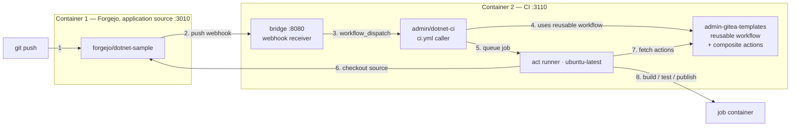

# Cross-instance Forgejo -> Gitea Pipeline Bridge

Source control runs on **Forgejo**, CI runs on a **separate Gitea** container
plus its act runner — simulating the common case where source and CI live on
different servers and different products.

A commit on the **Forgejo** container triggers a pipeline that runs on the
**Gitea** container. The source-control container is deliberately replaceable:
swap Forgejo for GitLab and only the webhook sender changes.

## Topology

| Container | Host port | Product | Owns | Actions |
|-----------|-----------|---------|------|---------|
| `forgejo` (application source) | 3010 | Forgejo 17.0.2 | `forgejo/dotnet-sample` only | **disabled**, no runner |
| `gitea-app` (CI) | 3110 | Gitea 28.3.0 | `admin/dotnet-ci` (caller) + `admin/admin-gitea-templates` (reusable workflow + composite actions) | enabled, runner with labels `ubuntu-latest`, `dotnet` |

**The application source exists only on 3010.** Nothing is mirrored or copied
into 3110 — the CI container never hosts the source repository.

**Both CI repositories live on 3110.** That is what makes `workflow_call` work:
Gitea resolves reusable workflows server-side and refuses a target on another
instance — and it cannot resolve one on Forgejo at all. `dotnet-ci` calls the
reusable workflow in `admin-gitea-templates` cross-repository but on the *same*
instance.

## Flow



1. Commit is pushed to `forgejo/dotnet-sample` on **3010**.
2. Forgejo **3010** sends its `push` webhook to the receiver.
3. The receiver calls `workflow_dispatch` on **3110**.
4. `ci.yml` calls the reusable workflow in `admin-gitea-templates` (same instance).
5. Gitea **3110** queues the job on the runner.
6. The runner clones the source from **Forgejo** (read-only, into the job workspace).
7. Composite actions are fetched from **3110**.
8. `dotnet restore` → `build` → `test` → `publish`.

## Is the bridge mandatory? Yes.

Both products have **outbound-only** webhooks. Per the
[Forgejo webhook docs](https://forgejo.org/docs/latest/user/webhooks/), a
webhook *sends* deliveries for repository/issue/pull-request/workflow events;
there is no inbound webhook endpoint and no `repository_dispatch` event for a
workflow to subscribe to.

The only remote trigger in the API is:

```text
POST /api/v1/repos/{owner}/{repo}/actions/workflows/{workflow_id}/dispatches
Body: {"ref": "main"}
```

A push webhook sends a push payload, so it cannot be pointed at this endpoint
directly. Something must translate one into the other — that is the bridge.

This is also why the split keeps working if container 1 becomes GitLab: GitLab
already sends push webhooks, so the receiver stays and only the payload parsing
changes.

### Rejected alternatives

| Option | Why not |
|--------|---------|
| Point the 3010 webhook straight at the 3110 dispatch API | Rejects push payloads; needs `{"ref":...}` |
| Use `repository_dispatch` | Does not exist in Gitea or Forgejo |
| Push-mirror the repo into 3110 | Triggers natively, but **duplicates the source** into the CI container — rejected by design |
| Reusable workflow (`workflow_call`) across instances/products | Gitea rejects it: *"an absolute URL must point to this Gitea instance"*. Works only on the same instance — see below |
| Put `ci.yml` beside the source in `application/` | See [below](#can-ciyml-live-beside-the-source) — detected but never runs without a runner on 3010 |

## Reusable workflow (`workflow_call`)

Both CI repositories live on **3110**, so a reusable workflow works normally:

```yaml
# dotnet-ci/.gitea/workflows/ci.yml
jobs:
  ci:
    uses: admin/admin-gitea-templates/.gitea/workflows/dotnet-ci.yaml@main
    secrets:
      SOURCE_TOKEN: ${{ secrets.SOURCE_TOKEN }}
    with:
      source_server_url: http://forgejo:3000
      source_repository: forgejo/dotnet-sample
```

The reusable workflow itself is
`admin-gitea-templates/.gitea/workflows/dotnet-ci.yaml` — it **must** sit under
`.gitea/workflows` (or `.github/workflows`) or Gitea will not detect it.

Gitea resolves `workflow_call` **server-side**, so the target must be on the
same instance as the caller. A cross-repository reference on one instance is
fine; a cross-*instance* one is not:

```text
resolve uses "http://forgejo:3000/.../dotnet-ci.yaml@main":
  unsupported reusable workflow URL: an absolute URL must point to this
  Gitea instance (http://localhost:3110/)
```

That is exactly why the templates repository moved next to `dotnet-ci` on 3110,
while only the application source stayed on 3010, in Forgejo.

### What the reusable workflow does

1. `actions/checkout` — official, fetched from GitHub. Checks out the
   **application source from 3010** into `application/` using
   `github-server-url` + `repository` + a source token.
2. `actions/setup-dotnet` — official, honours `dotnet_version`.
3. `actions/cache` — official, caches `~/.nuget/packages`.
4. `dotnet-build-test` composite action — restore, build, test (TRX).
5. `dotnet-publish` composite action — publish + record `source-commit.txt`.

### Checking out source from the other instance

`actions/checkout` checks out the repository the workflow runs in, so the source
must be named explicitly. Two constraints, both verified:

- `repository` must be `owner/repo` — a full URL is rejected:
  `::error::Invalid repository 'http://...'. Expected format {owner}/{repo}.`
- the host comes from `github-server-url`, and `token` is **required** even for
  a public repository (`::error::Input required and not supplied: token`).

```yaml
- uses: https://github.com/actions/checkout@v4
  with:
    repository: ${{ inputs.source_repository }}
    github-server-url: ${{ inputs.source_server_url }}
    token: ${{ secrets.SOURCE_TOKEN }}
    ref: main
    path: application
```

That token belongs to the **Forgejo** instance, so it is created there and
stored as a repository secret on `dotnet-ci`:

```bash
# On the Forgejo container: mint a read-only source token.
docker exec gitea-actions-forgejo-1 s6-setuidgid git forgejo admin \
  user generate-access-token --username forgejo \
  --token-name ci-source-read --scopes read:repository

# Store it on the CI instance as the secret the checkout uses.
curl -s -X PUT -u admin:admin -H 'Content-Type: application/json' \
  -d "{\"data\":\"$TOKEN\"}" \
  http://localhost:3110/api/v1/repos/admin/dotnet-ci/actions/secrets/SOURCE_TOKEN
```

Forgejo accepts that token as the password of any username, which is what
`actions/checkout` sends (`AUTHORIZATION: basic base64(x-access-token:TOKEN)`).
A `read:repository` token is enough to clone; `write:repository` is needed to
push, and creating a repository over the API additionally needs `write:user`.

### Two things that made it run

- **`runs-on: ubuntu-latest`** maps to the upstream act image
  (`catthehacker/ubuntu:act-latest`), which ships Node + bash + git. The .NET SDK
  image has no Node, so official JavaScript actions fail there with
  `exec: "node": executable file not found in $PATH`.
- **`DOTNET_SYSTEM_GLOBALIZATION_INVARIANT: "1"`** in the reusable workflow's
  job `env:`. That image has no ICU, so the CLI otherwise aborts with
  `Couldn't find a valid ICU package installed`. It must be set *inside* the
  called workflow — a caller's job-level `env:` does not propagate into it.

## Can `ci.yml` live beside the source?

Short answer: **it can be detected and dispatched, but it will not run** unless
you also enable actions *and* register a runner on 3010 — which collapses the
two-container split and breaks the GitLab-swap plan. So we keep it in `dotnet-ci`.

A workflow file is just a file the runner reads. Putting
`.gitea/workflows/ci.yml` in `application/` on 3010 works mechanically:

1. Gitea detects it (`state=active`) and the workflow shows in the UI.
2. `workflow_dispatch` against 3010 returns `204`.

But the job never runs, because **a runner polls only its own instance**. Gitea
Actions is outbound-only: there is no way for the runner on 3110 to pull a job
queued on 3010. The workflow only executes if 3010 has `[actions] ENABLED = true`
and a runner registered to it.

Doing that reintroduces a runner on the source-control instance, which:

- duplicates the CI role back onto 3010 (no clean source/CI separation), and
- forces a second runner/config when 3010 is later swapped for GitLab.

Empirical result (tested):

| `ci.yml` location | Detected | `workflow_dispatch` → 204 | Actually runs? |
|-------------------|----------|----------------------------|----------------|
| `dotnet-ci` (3110) | yes | yes | ✅ success (runner on 3110) |
| beside source (3010) | yes | yes | ❌ cancelled / runner crash — needs actions + runner on 3010 |

## Configuration

### 1. Runner registration token (3110)

```bash
curl -s -X POST -u admin:admin \
  http://localhost:3110/api/v1/admin/actions/runners/registration-token
# -> deployments/.env : GITEA_RUNNER_REGISTRATION_TOKEN
```

### 2. Bridge access token (3110)

```bash
curl -s -X POST -u admin:admin -H "Content-Type: application/json" \
  -d '{"name":"ci-bridge","scopes":["write:repository"]}' \
  http://localhost:3110/api/v1/users/admin/tokens
# -> deployments/.env : GITEA_CI_TOKEN (the sha1 value)
```

### 3. Webhook egress allow-list (3010 and 3110)

Both products refuse webhooks to private addresses by default:

```text
denied by egress policy: bridge(172.29.0.5) needs an explicit IP allow entry
```

The section differs by product, which is easy to miss:

```ini
# Forgejo 17 (deployments/forgejo/app.ini)
[webhook]
ALLOWED_HOST_LIST = private

# Gitea 28 (deployments/gitea-app/app.ini)
[security]
ALLOWED_HOST_LIST = private
```

Three gotchas:

- Forgejo keeps `ALLOWED_HOST_LIST` under `[webhook]`; Gitea 28 moved it to
  `[security]` and warns if you use `[webhook]`.
- `*` is **rejected** (`catch-all host pattern "*" ... is not allowed`).
- A hostname entry does **not** cover a private IP; use the `private` builtin
  (`10/8`, `172.16/12`, `192.168/16`, `fc00::/7`, `100.64/10`) or an explicit CIDR.

`docker-compose.yaml` also passes them as environment overrides so they survive
a stale data volume:

```yaml
FORGEJO__webhook__ALLOWED_HOST_LIST: ${WEBHOOK_ALLOWED_HOSTS:-private}
GITEA__security__ALLOWED_HOST_LIST:  ${WEBHOOK_ALLOWED_HOSTS:-private}
```

Forgejo reads `FORGEJO__<section>__<KEY>`; Gitea reads
`GITEA__<section>__<KEY>`. Using the wrong prefix is silently ignored.

### 4. The push webhook (3010)

```bash
curl -s -X POST -H "Authorization: token $FORGEJO_TOKEN" \
  -H "Content-Type: application/json" \
  -d '{"type":"gitea","active":true,"events":["push"],
       "config":{"url":"http://bridge:8080/hook","content_type":"json"}}' \
  http://localhost:3010/api/v1/repos/forgejo/dotnet-sample/hooks
```

UI equivalent on 3010: repository → Settings → Webhooks → Add webhook → Gitea,
target `http://bridge:8080/hook`, content type `application/json`, trigger
**Push events**. Forgejo keeps the `gitea` hook type for payload compatibility.

Forgejo sends `X-Forgejo-Event` plus the legacy `X-GitHub-Event`,
`X-Gitea-Event` and `X-Gogs-Event` headers on every delivery, so
`bridge.py` accepts any of them.

## Quick start

```bash
cd deployments
docker compose --env-file .env up -d --wait forgejo gitea-app
docker compose --env-file .env up -d runner bridge
```

Create three empty public repositories and push each directory:

| Directory | Repository | Instance |
|-----------|-----------|----------|
| `application/` | `forgejo/dotnet-sample` | Forgejo 3010 |
| `gitea-templates/` | `admin/admin-gitea-templates` | Gitea 3110 |
| `dotnet-ci/` | `admin/dotnet-ci` | Gitea 3110 |

Then apply steps 1–4 and push any commit to the application repository on 3010.

## Verify

```bash
docker logs --since 5m gitea-actions-bridge-1 | grep bridge
```

```text
[bridge] push to refs/heads/main -> dispatching admin/dotnet-ci ci.yml@main
[bridge] dispatched (HTTP 204)
```

```bash
curl -s -u admin:admin \
  http://localhost:3110/api/v1/repos/admin/dotnet-ci/actions/runs
```

Expect `event=workflow_dispatch`, `conclusion=success`, and in the job log
`Passed: 3, Failed: 0`.

UI: <http://localhost:3010> (`forgejo` / `forgejo`) and
<http://localhost:3110> (`admin` / `admin`).
The run appears under **3110 → admin/dotnet-ci → Actions**; the 3010 repository
has no Actions tab because actions are disabled there.

## Design notes

- **Reusable workflows must be same-instance** — Gitea resolves `workflow_call`
  server-side. Both CI repositories therefore live on 3110.
- **Composite actions can also be cross-instance** (the runner fetches them at
  run time), but here they are same-instance, so plain URLs are enough.
- `runs-on: ubuntu-latest` maps to `catthehacker/ubuntu:act-latest` (upstream,
  no custom build) which has Node + bash, so official JS actions run.
- Invariant globalization is required on that image (no ICU):
  `DOTNET_SYSTEM_GLOBALIZATION_INVARIANT: "1"`.
- `actions/checkout` fetches the source from Forgejo via `github-server-url`; it
  needs `repository` as `owner/repo` and a non-empty `token` scoped to Forgejo.
- The bootstrap hook seeds `app.ini` **once**; editing the tracked file after
  first start does not update the config inside the data volume.
- Forgejo's image has no `su-exec` and reserves the `admin` username, so the
  bootstrap uses `s6-setuidgid git` and the lab account is `forgejo`.
- On Windows use Git Bash and prefix docker entrypoint overrides with
  `MSYS_NO_PATHCONV=1`.

## Layout

```
application/                forgejo/dotnet-sample  (3010) — source only
  src/                      minimal API: /health, /weatherforecast
  tests/                    xUnit tests (WebApplicationFactory<Program>)
  Dockerfile
gitea-templates/            admin/admin-gitea-templates  (3110) — CI instance
  .gitea/workflows/dotnet-ci.yaml        reusable workflow (workflow_call)
  actions/dotnet-build-test/action.yml   restore + build + test
dotnet-ci/                  admin/dotnet-ci  (3110) — the caller
  .gitea/workflows/ci.yml                workflow_dispatch entry point
deployments/
  docker-compose.yaml       Forgejo + Gitea + runner + bridge
  bridge/bridge.py          push webhook -> workflow_dispatch translator
  forgejo/app.ini           Forgejo, actions disabled
  gitea-app/app.ini         Gitea, actions enabled
  runner/config.yaml        labels, job network, capacity
```
